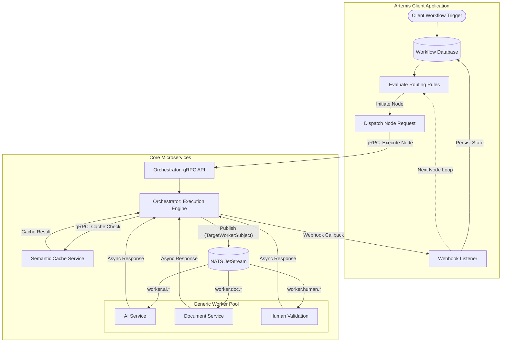

# AI Document Orchestrator Service

Welcome to the **AI Document Orchestrator Service**, the central "Manager" in the microservice architecture for processing unstructured scanned documents using Multimodal LLMs. It is a 100% application-agnostic, decoupled execution engine operating on a LangGraph-style state machine model.

## Documentation Index

1. **[Core Components](docs/01_Core_Components.md)**  
   Details on the LangGraph state architecture, routing via `OrchestratorPrimitive`, and hardware-aware queue tuning.
2. **[How to Implement](docs/02_How_To_Implement.md)**  
   Instructions for running the orchestrator via Docker or local development, and testing with a dummy client.
3. **[Service Communication](docs/03_Service_Communication.md)**  
   Details on the Context Envelope Pattern, semantic cache integration, and strict No Preemptive Serialization mandates.

---

## High-Level Architecture

